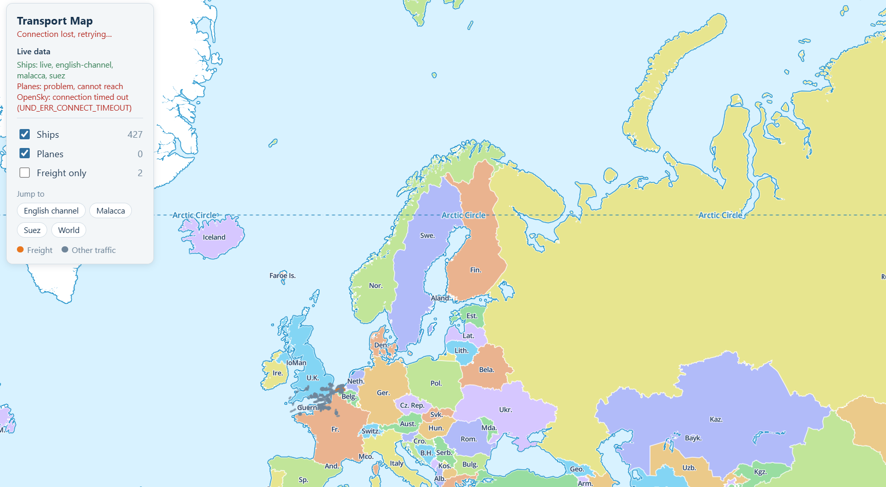

# Transport Map

**A live world map of ships and planes, with freight highlighted.** Click any vessel to see where it is going, what type it is, how fast it is moving, and the path it has taken.

<!-- Add a screenshot or short GIF here, for example:  -->


> A hobby project built with TypeScript, React, MapLibre and deck.gl. It runs out of the box on sample data, and switches to real ship and plane feeds when you add free API credentials.

## Features

- **Live ships** from [AISStream](https://aisstream.io), including small Class B vessels, in the sea areas you choose.
- **Live planes** from the [OpenSky Network](https://opensky-network.org), with an anonymous fallback if you have no credentials.
- **Freight highlighted** in orange: cargo ships and tankers (from AIS ship type) and known freight airlines such as FedEx, UPS and DHL (from callsign).
- **Click a vehicle** for its destination, vessel type, cargo category, speed, ETA and position.
- **Route and path lines:** a planned route to the destination (following shipping lanes for ships) and the path the vessel has travelled since the app started watching it.
- **Destination matching** against about 11,800 ports (UN/LOCODE), cleaning up the messy free text that crews type into AIS.
- **Smooth motion** between updates, and a map that stays responsive with tens of thousands of vessels.
- **Feed status panel** that says whether each data source is live, connecting, off or failing, and why.
- **Offline mode** with synthetic ships and planes, so you can develop with no keys and no rate limits.

## Quick start

Requires **Node.js 20.19+ or 22** (see `.nvmrc`).

```bash
git clone <your-repo-url>
cd transport-map
npm install
npm run dev
```

Open <http://localhost:5173>. The API server runs on port 3001.

It starts in **fixtures mode** (sample data). To see real traffic, follow the next section.

## Using live data

1. Copy the example settings: `cp .env.example .env` (never commit `.env`).
2. **Ships:** get a free key at [aisstream.io](https://aisstream.io) and set `AISSTREAM_API_KEY`.
3. **Sea areas:** set `AIS_REGIONS`. Ships only appear inside the areas you list, for example:
   ```
   AIS_REGIONS=north-sea,mediterranean,suez,hormuz,malacca,east-china-sea,us-east-coast,us-west-coast
   ```
4. **Planes (optional):** with no credentials the app uses OpenSky's anonymous access, which has a small allowance, so planes refresh every 15 minutes by default. For more, create an API client on your OpenSky account page and set `OPENSKY_CLIENT_ID` and `OPENSKY_CLIENT_SECRET`.
5. Set `DATA_MODE=live` and restart.

### Settings

| Variable | Default | Purpose |
|---|---|---|
| `DATA_MODE` | `fixtures` | `fixtures` for sample data, `live` for real feeds |
| `AISSTREAM_API_KEY` | none | AISStream key (ships) |
| `AIS_REGIONS` | `english-channel,malacca,suez` | Comma-separated sea-area presets, or `world` |
| `OPENSKY_CLIENT_ID`, `OPENSKY_CLIENT_SECRET` | none | OpenSky API client (planes) |
| `OPENSKY_POLL_SECONDS` | `120` | Plane refresh interval when signed in |
| `OPENSKY_ANON_POLL_SECONDS` | `900` | Plane refresh interval without credentials |
| `PORT` | `3001` | API server port |

Available `AIS_REGIONS` presets: `english-channel`, `north-sea`, `baltic`, `mediterranean`, `gibraltar`, `suez`, `red-sea`, `hormuz`, `india-west`, `malacca`, `east-china-sea`, `japan`, `us-west-coast`, `us-east-coast`, `gulf-of-mexico`, `panama`, `brazil`, `west-africa`, `australia-east`, `world`.

## How it works

```
Browser (React + MapLibre + deck.gl)
   ^  WebSocket /stream   snapshot on connect, then compressed deltas every ~3 s
   |  REST  /api/vehicles, /api/vehicles/:id, /:id/route, /:id/track, /api/health
Server (Fastify)
   ingest/    OpenSky poller, AISStream client, fixture replay  ->  VehicleStore
   store/     in-memory vehicles with expiry, change log and path history
   enrich/    freight rules, port and destination matching
   routing/   great-circle (planes), shipping-lane routes (ships)
```

- API keys stay on the server; the browser only talks to this project's own endpoints.
- The server sends only what changed. The browser slides each vehicle along its heading between reports (dead reckoning) and thins what it draws when many vessels are on screen.
- Routes and paths are fetched only for the selected vessel.

### Tech stack

TypeScript everywhere (npm workspaces), React 18 and Vite, MapLibre GL JS with deck.gl for rendering, Zustand for UI state, Node with Fastify and `ws` on the server, Turf.js and `searoute-js` for routing, and Vitest for tests.

### Project structure

```
apps/server       Fastify server: ingest, enrichment, routing, API
apps/web          React app: map, panels, layers
packages/shared   Types shared by both (Vehicle, RouteGeometry, StreamMessage)
data/             Ports (generated), curated ports, airports, freight callsigns, aliases
fixtures/         Synthetic sample feeds for offline development
scripts/          build-ports.mjs regenerates data/ports.csv from UN/LOCODE
docs/             PLAN.md (milestones), ARCHITECTURE.md
```

## Scripts

| Command | What it does |
|---|---|
| `npm run dev` | Server and web app together, with live reload |
| `npm test` | Server tests (parsing, destination matching, routing, store, plus integration tests against fake AISStream and OpenSky servers) |
| `npm run typecheck` | Type-check all packages |
| `npm run build` | Build the web app (the server serves it in production) |
| `npm start` | Run the server, serving `apps/web/dist` if built |
| `node scripts/build-ports.mjs` | Regenerate `data/ports.csv` from the open UN/LOCODE dataset |

## Good to know

- **Ships do not broadcast their origin**, only a destination. "Path so far" shows where this app has watched a ship travel since it started.
- **Details arrive slowly.** A ship sends its name, type and destination about every 6 minutes, so details and freight highlighting fill in gradually after startup. Small boats send a name and type but never a destination.
- **Cargo is a category, never exact contents.** Neither AIS nor ADS-B broadcasts what is on board. Categories are inferred from ship type or airline.
- **Planes have no destination yet.** The plane feed does not include one; a route lookup is on the roadmap.
- **Routes are estimates**, drawn along a shipping-lane network for realistic-looking paths, not for navigation. If the lane route is absurdly long (for example trans-Pacific), a straight line is drawn instead.
- **Coverage is patchy.** AISStream relies on shore-based receivers, so the open ocean is mostly empty.
- **Port data has gaps.** About 5,800 UN/LOCODE ports have no coordinates, so some destinations show as unknown. See `data/README.md`.

## Troubleshooting

| Symptom | What to check |
|---|---|
| Vehicles and panels show but the map layer is blank | Look for "Worker failed to load" in the browser console. `apps/web/src/map/MapView.tsx` points MapLibre at its worker file with `setWorkerUrl`; keep that when upgrading MapLibre. |
| Terminal says `mode: fixtures` but you wanted live data | Read the `[config]` lines printed at startup. They say whether a `.env` was found and what it contained. Common causes: the file is named `.env.txt` (Windows hides extensions), it is in the wrong folder (it belongs next to `package.json`), or `DATA_MODE=live` is missing. Create it with `cp .env.example .env` and edit it in a normal editor such as VS Code (UTF-8). |
| Ships only appear in a few places | They only appear inside the areas in `AIS_REGIONS`. Add more, or use `world`, then restart. |
| Everything looks like one blob | Zoom in, or use the **Jump to** buttons in the controls panel. |
| Ships seem not to move | At 12 knots a ship moves about 6 m/s, under a pixel a minute at regional zoom. Zoom in, or select a ship to watch its path build up. |
| Ships show "Not received yet" | Normal at first. Identity data arrives about every 6 minutes per ship. |
| Planes show a connection error | The panel gives the reason (for example `connection timed out`). OpenSky can be down or unreachable from your network; the app keeps retrying. |
| `ws proxy error: ECONNABORTED` during `npm run dev` | Harmless. React StrictMode opens the WebSocket twice in development. |
| Red 404 messages after clicking a plane | Expected. Planes have no known destination, so their route request returns 404. |

## Data sources and attribution

- **Ships:** [AISStream](https://aisstream.io) (AIS).
- **Planes:** [OpenSky Network](https://opensky-network.org) (ADS-B).
- **Ports:** [UN/LOCODE](https://unece.org/trade/cefact/unlocode-code-list-country-and-territory) via the open [datasets/un-locode](https://github.com/datasets/un-locode) repository, plus a small hand-checked list.
- **Map:** [MapLibre GL JS](https://maplibre.org). The default basemap is the MapLibre demo style, which is fine for development; replace it before sharing publicly.
- **Routing:** [searoute-js](https://github.com/johnx25bd/searoute-js) and [Turf.js](https://turfjs.org).

These feeds are used under their free, non-commercial terms. **Check each provider's current terms before any public or commercial use.** For example, OpenSky requires a written agreement for live products, and AISStream's commercial terms should be confirmed with them.

## Roadmap

- [ ] Test and tune against real AISStream and OpenSky traffic
- [ ] Plane destinations (route lookup) and aircraft type database
- [ ] Fuller port coverage (for example the NGA World Port Index)
- [ ] Search by ship name or callsign
- [ ] Deployment guide (one persistent Node process; WebSockets need it)
- [ ] Rail and road layers

See `docs/PLAN.md` for the detailed milestone list.

## Contributing

Issues and pull requests are welcome. Please run `npm run typecheck` and `npm test` before opening a pull request.